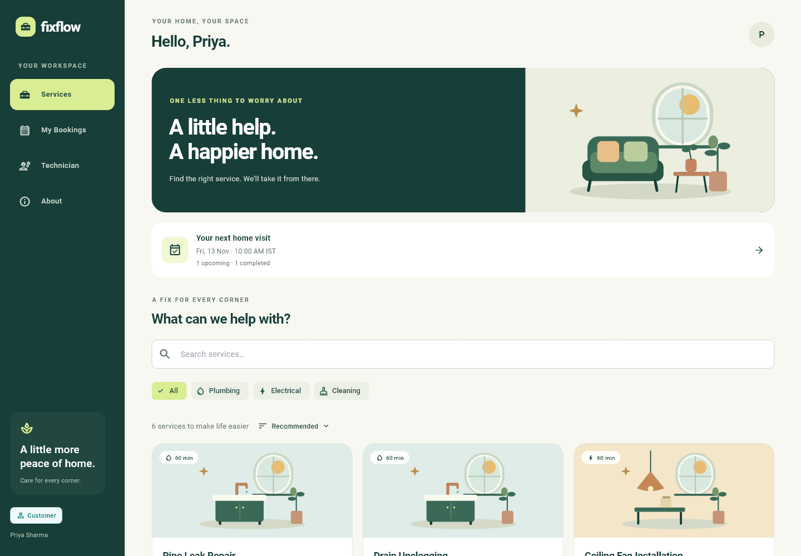

# FixFlow

A personal Flutter portfolio project for fictional home-service bookings. A customer chooses a service and appointment, the assigned technician advances the job, and the customer reviews completed work.

**Default demo:** no account, credentials or backend required. All people, services and bookings are fictional. Data stays in this browser profile/device and survives refresh. The persona switch simulates different participants in one local workspace; it is not authentication.

Source: [saiganeshraj/fixflow-flutter](https://github.com/saiganeshraj/fixflow-flutter).
Public demo: **not deployed yet**. Walkthrough video: **not recorded yet**.

## Run it

Validated toolchain: Flutter 3.47.2 stable / Dart 3.13.2. Use the checked-in lockfile.

**D: drive requirement:** use the project launcher below. It keeps SDK/cache/temp work under ignored `.local-tools` on D:, without changing global settings. See [workspace setup](docs/WORKSPACE.md).

```powershell
.\tools\flutter.cmd pub get
.\tools\preview.cmd -Rebuild
```

The verified local browser preview uses release mode at `http://127.0.0.1:8080`.
Use `.\tools\preview.cmd` to reopen it without rebuilding. Chrome debug mode
currently stalls on this machine; that toolchain issue remains separate.

Select **Try the Demo**, book Pipe Leak Repair for an available IST slot using a fictional address, switch to the assigned technician, accept and advance each stage, then return to Priya and review the booking in History. Reset is available in the persona menu with confirmation. Android run/build steps are in [deployment](docs/DEPLOYMENT.md).

## Implemented features

* Six fixed-price services across plumbing, electrical and cleaning, with combined search/category filters, price sorting, details and inclusions.
* Future hourly slots in Asia/Kolkata, deterministic eligible technician assignment, cross-service conflict checks, integer paise price snapshots and scoped idempotency.
* Booking confirmation, upcoming/history lists, status filter, explicit refresh, detail and immutable event timeline.
* Assigned technician actions, enforced stage transitions, cancellation policy and one customer review per completed booking.
* Versioned local persistence, failed-save rollback, corrupt-data recovery and visitor-local reset.
* Illustrated welcome page and service cards, personal booking overview, desktop sidebar/tablet rail/mobile navigation, locally bundled licensed Roboto fonts, labelled statuses and loading/error/empty states.
* Opt-in Supabase email/password authentication, trusted profiles and repository adapter; migrations, RLS, transactional RPCs and database test scripts are implemented. **Database execution and real multi-account integration are not yet verified.**

## Screenshots

These are actual Flutter widget-renderer captures at the stated logical widths, not browser/device screenshots. Font assets are loaded for capture. Browser inspection is tracked separately.



[Phone, 360px](docs/screenshots/catalog-360.png) · [Tablet, 768px](docs/screenshots/catalog-768.png)

## Architecture

**Riverpod is used throughout.** Immutable catalog controls, cached derived
filtering/sorting, asynchronous providers and scoped booking streams are explained
with an interview walkthrough in [State management](docs/STATE_MANAGEMENT.md).
See the [design refresh](docs/DESIGN_REFRESH.md) for the visual changes and scope.

`lib/app` holds theme, routing, startup/mode gates and Riverpod wiring. `lib/features` groups catalog, bookings, technician screens and authentication. `AppRepository` shares contracts between `lib/demo/demo_repository.dart` and `lib/features/bookings/live_repository.dart`. `lib/core` contains the injected clock, errors, storage and shared states.

Widgets collect input and display async provider state. Repositories enforce domain rules. Demo writes are serialized and persisted before success notifications. Live SQL derives identity and price, enforces assignments/transitions and reserves slots transactionally; client-side validation is not its security boundary.

Demo storage is small JSON in SharedPreferences, not SQL or offline sync. Different browser profiles are isolated. Multiple tabs in the same profile share that storage and are not independent transactional writers. Live data refreshes after mutations, on screen revisit and via explicit refresh; realtime is excluded.

## Checks and release preview

```powershell
.\tools\dart.cmd format --output=none --set-exit-if-changed lib test integration_test
.\tools\flutter.cmd analyze
.\tools\flutter.cmd test
.\tools\flutter.cmd build web --release
node tools/preview.mjs
```

Preview at `http://127.0.0.1:8080`. Web uses hash routes such as `/#/catalog`; Firebase hosting config is included. The 48-test suite covers business rules, concurrent submissions, persistence failures/recovery, the complete UI journey, three layout widths and HTTP adapter behavior. See [test evidence and pending platform checks](docs/TESTING.md). The CI workflow is configured; a public GitHub CI run has not been observed.

## Live backend and limits

Follow [BACKEND.md](docs/BACKEND.md) to apply migrations to a disposable development database, run pgTAP, provision technicians and verify distinct authenticated sessions. Copy `config/live.example.json` to ignored `config/live.json`, supply only a project URL/publishable key, then run `flutter run -d chrome --dart-define-from-file=config/live.json`. A client-visible key is configuration, never a secret substitute for RLS. The default demo does not initialize Supabase.

No real dispatch, payments, maps, chat, notifications, admin marketplace, production deployment, app-store release or iOS validation is claimed. Release Android signing needs an owner-provided keystore. Compilation, device operation and database authorization are separate verification stages.

## Project record and learning

* [Product specification](docs/PRODUCT_SPEC.md)
* [Handoff audit and current progress](docs/PROGRESS.md)
* [Testing](docs/TESTING.md) and [deployment](docs/DEPLOYMENT.md)
* [Interview notes and first five files](docs/INTERVIEW_NOTES.md)
* [Video script, truthful resume entry and recruiter draft](docs/WALKTHROUGH.md)

The project began with an AI-assisted Antigravity scaffold and was continued with Codex. This is a personal project, not employment experience or production business impact. Roboto font license: [assets/fonts/LICENSE.txt](assets/fonts/LICENSE.txt).
