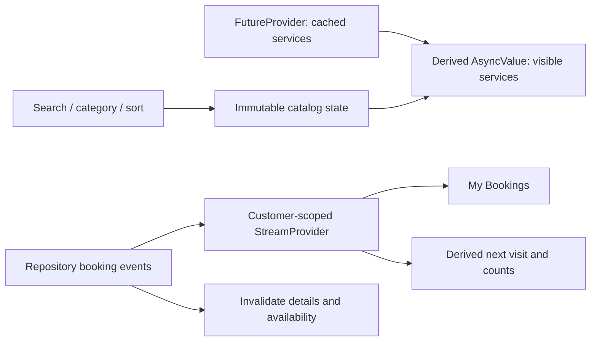

# State management in FixFlow

FixFlow uses **flutter_riverpod 2.6**. The project already used Riverpod before
the visual refresh; the refresh adds a unified catalog controller and a derived
booking overview. A second state-management package is unnecessary.

## What to demonstrate

1. On Services, type a search, select a category, and change the price sort.
   These controls compose without fetching the catalog again. Open a service
   and return: the query, category and order remain consistent.
2. Create a booking. The catalog overview and My Bookings consume the same
   customer-scoped stream. There are no independently maintained booking counts.
3. Switch to the assigned technician and advance the job. Switch back to the
   customer: details, counts and availability derive from repository changes.
4. Refresh the browser. Demo bookings and the selected persona restore from local
   storage. Catalog filters intentionally last for the running app session only.

## Read the implementation

| Responsibility | File / provider |
| --- | --- |
| Immutable query/category/order | `lib/features/catalog/catalog_state.dart` — `catalogFiltersProvider`, `CatalogFiltersController` (`Notifier`) |
| Cached asynchronous catalog | `lib/app/providers.dart` — `servicesProvider` (`FutureProvider`) |
| Derived visible services | `filteredServicesProvider` (`Provider<AsyncValue<List<Service>>>`) |
| Scoped booking updates | `customerBookingsProvider(customerId)` (`StreamProvider.autoDispose.family`) |
| Derived counts / next appointment | `bookingOverviewProvider` and `BookingOverview` |
| Detail and availability refresh | `repositoryRevisionProvider`, `bookingDetailProvider`, `availableSlotsProvider` |
| Repository lifetime / test doubles | `repositoryProvider`, `ref.onDispose`, `ProviderScope` overrides |
| Persona restoration | `activePersonaProvider` (`StateNotifierProvider`) and `LocalStorage` |

The repository owns business rules and persistence. Riverpod owns dependency
lifetimes, asynchronous loading/error states, and reactive view projections.
Widgets retain genuinely local interaction state: text controllers, tabs and
pointer hover. Putting every widget detail in a global provider would add coupling.

## Interview explanation

“I use Riverpod to separate UI state, asynchronous data and business rules.
The catalog has one immutable Notifier state for its filters and sort order.
Its visible list is derived from cached services, preserving AsyncValue loading
and errors. Booking screens share a customer-scoped stream; the dashboard derives
its counts from that stream rather than duplicating mutable state. Repository
changes refresh dependent details and slots. I test the providers with overrides,
including composed filters, failures, stream updates and customer changes.”

`test/catalog_state_test.dart` verifies those new provider behaviors. The existing
journey and repository tests cover booking, technician stages, reviews, failed
saves and concurrency. This does not establish real database authorization or
cross-device realtime: live Supabase and device acceptance remain separate work.
